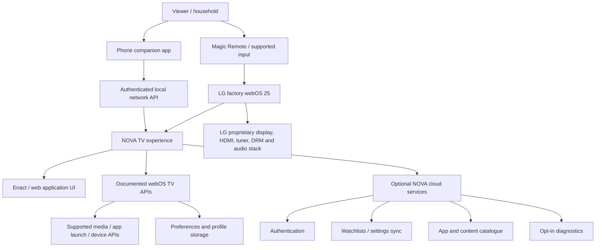
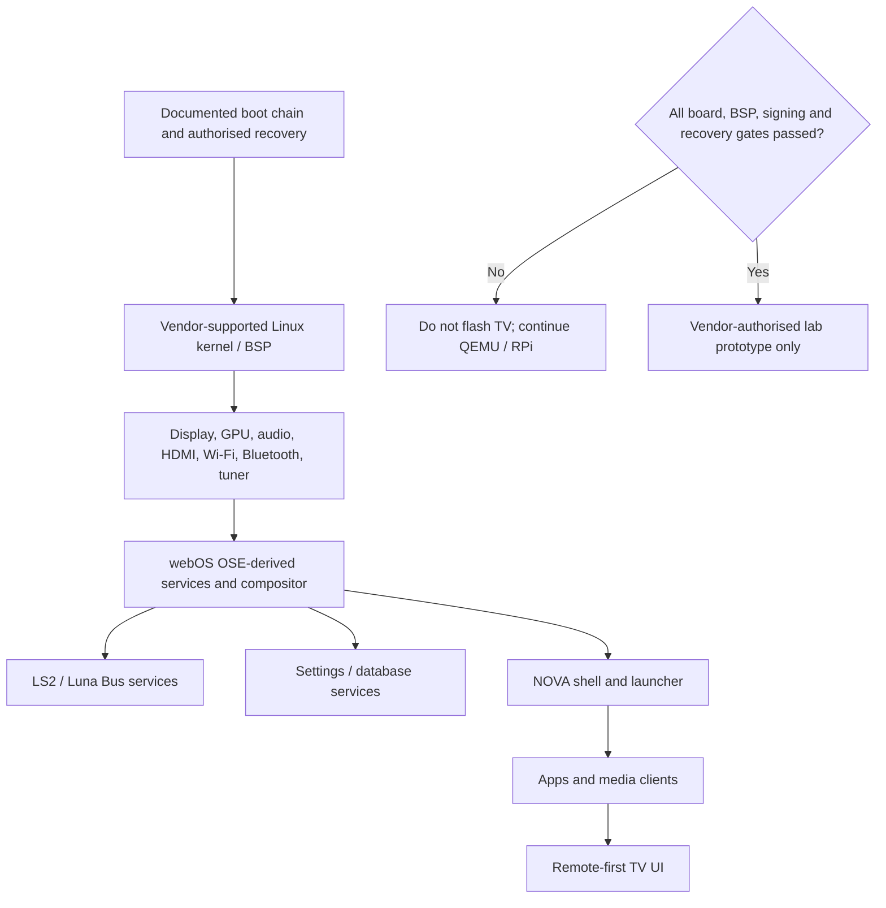
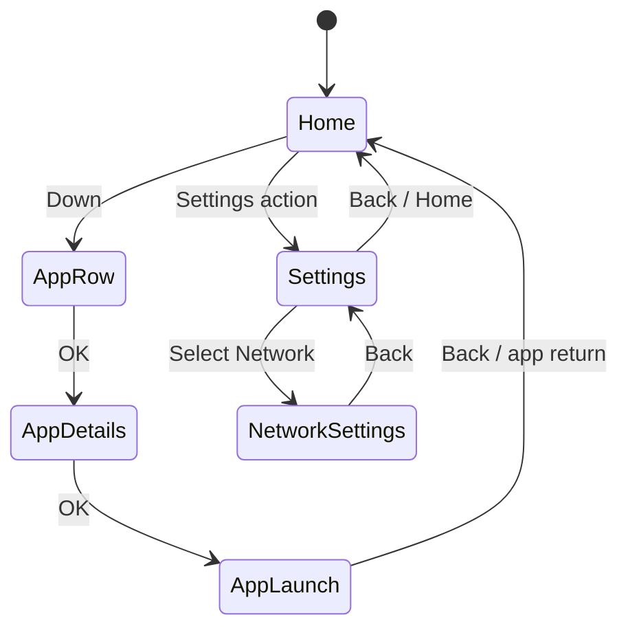
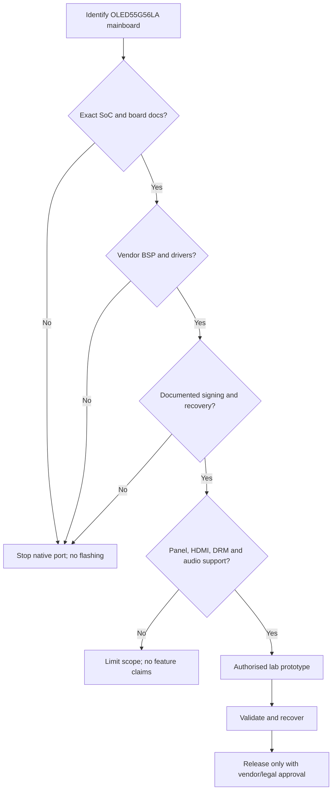

# NOVA TV OS — LG OLED evo G5 (OLED55G56LA)
### Model-specific A-to-Z engineering blueprint, development roadmap, and safety-gated porting guide

> **Project:** NOVA TV OS  
> **Target TV:** LG OLED evo AI 55-inch G5 — **OLED55G56LA** (India SKU)  
> **Factory platform:** LG webOS 25 (2025 generation)  
> **TV processor:** α11 AI Processor 4K Gen2  
> **Display:** 4K OLED, 55-inch  
> **Gaming:** VRR up to 165 Hz on supported inputs/content; feature behavior varies by input mode  
> **HDR/audio:** Dolby Vision, Dolby Atmos  
> **Document status:** Research-backed development plan. This is not an approved LG firmware replacement procedure.

---

## 0. Read this first — feasibility and safety

This project has two different goals. They must not be confused:

1. **NOVA TV OS experience (recommended):** Build a custom launcher/dashboard, apps, services, media interface, companion application, and cloud ecosystem that can be developed and tested without replacing the LG factory firmware. Deploy only through supported webOS TV application/developer mechanisms.
2. **Native NOVA operating-system port (research-only until proven):** Investigate whether a separate Linux/webOS-OSE-derived image can boot on the exact OLED55G56LA mainboard. This requires board-level identification, boot-chain documentation, vendor kernel/BSP, device drivers, signing/secure-boot information, and a recoverable development target. Public documentation does not establish that this TV is an OSE-supported target.

**Do not assume that the α11 AI Processor Gen2 is a publicly documented, general-purpose SoC for third-party OS builds.** LG markets it as an AI picture/sound processor. The public product specification does not disclose the complete mainboard architecture, bootloader, memory map, kernel configuration, GPU/display driver interfaces, or firmware signing process needed for a port.

**Never**:
- flash Raspberry Pi images, generic ARM images, or an OSE image to this TV;
- write to eMMC/NAND, bootloader, partitions, or service areas based on guesses;
- short service pads, use undocumented UART/JTAG procedures, bypass secure boot, or defeat firmware signatures;
- assume that an app running on webOS gives root access or permits OS replacement;
- promise that Dolby Vision, Dolby Atmos passthrough, HDCP-protected playback, HDMI 2.1, VRR 165 Hz, Wi-Fi/Bluetooth, tuner, or panel control will work on a custom OS.

An incorrect low-level change can permanently brick the TV, disable panel control, break HDMI/DRM, or make factory recovery impossible. Keep the original TV firmware intact.

### 0.1 What is verified and what is not

| Item | Status | Engineering consequence |
|---|---|---|
| Exact India model OLED55G56LA | Verified on LG India product page | Use this SKU when collecting documentation |
| 2025 G5 family / webOS 25 | Verified in LG product and launch information | Treat commercial TV software as a separate platform |
| α11 AI Processor 4K Gen2 | Verified marketing/specification | Does not reveal a public Linux BSP or bootable target |
| 4K OLED, Dolby Vision/Atmos | Product feature | Custom OS support is not implied |
| VRR up to 165 Hz | Advertised for supported 55-inch G5 input/content | Do not assume an OSE display stack can expose it |
| Mainboard part number and board revision | Not verified for this unit | Must be collected from lawful service documentation / authorised service |
| Exact CPU ISA, SoC vendor/part number, RAM and storage topology | Not established by public consumer specification | Mandatory porting discovery gate |
| Bootloader, secure-boot chain, signing keys, recovery method | Not established | No native image flashing until documented and authorised |
| Public OSE machine target for OLED55G56LA | Not found in official OSE supported-target list | No known ready-made OSE image for this TV |
| α11 Gen2 Linux BSP / display drivers | Not established by the cited public material | Native port feasibility remains unknown |

If any of the unknown items remain unknown, continue with the app/companion track and use QEMU/Raspberry Pi for native OSE experimentation.

---

## 1. Project vision

NOVA TV OS is a modular smart-TV experience with:
- a premium 4K television home screen;
- fast app launcher and app library;
- HDMI/input source dashboard (where supported by permitted APIs);
- media library and streaming-app launch integration;
- voice/search interface (with user consent and supported services);
- profiles, watchlists, recommendations and parental controls;
- network, device and privacy settings;
- phone companion app and local-network remote;
- update, diagnostics, crash reporting and accessibility;
- a plugin/service architecture that can evolve independently of the TV's factory OS.

### 1.1 Product principles

1. **Preserve the panel and factory platform.** Never trade a working OLED TV for an unverified OS experiment.
2. **Respect platform boundaries.** Use documented webOS TV APIs, permissions, app packaging and developer mode.
3. **Separate UI from privileged TV functions.** An app cannot legitimately replace proprietary display, tuner, HDMI, audio or secure-media services.
4. **Fail closed.** If an API or hardware feature is unavailable, show “Not supported on this model/firmware” rather than simulating a successful operation.
5. **Privacy by design.** Local-first preferences, explicit microphone permissions, minimal telemetry and clear data deletion.
6. **Reproducible engineering.** Pin SDK versions, record firmware version, maintain a test matrix and sign release artifacts.

### 1.2 Non-goals for the first release

- Replacing LG's bootloader or factory firmware.
- Reimplementing α11 AI picture processing.
- Claiming native 165 Hz panel drive from an app.
- Recreating licensed Dolby Vision/Atmos, HDCP or DRM stacks.
- Accessing undocumented service menus, hidden partitions or protected keys.
- Guaranteeing installation on every LG webOS model or firmware.

---

## 2. Exact target device profile

### 2.1 Known model identity

| Property | Target |
|---|---|
| Manufacturer | LG Electronics |
| Product family | OLED evo AI G5 |
| Screen size | 139 cm / 55-inch |
| Exact India model | **OLED55G56LA** |
| TV generation | 2025 |
| Factory OS family | webOS 25 |
| Processor branding | α11 AI Processor 4K Gen2 |
| Resolution | 3840 × 2160 |
| Display technology | OLED |
| Refresh / gaming | VRR advertised up to 165 Hz for supported inputs/content |
| HDR | Dolby Vision, HDR10, HLG (model/region/input support applies) |
| Audio | Dolby Atmos support; TV's advertised audio configuration is model-specific |
| HDMI | Four HDMI 2.1-class inputs are listed in LG's 2025 G5 range material; confirm exact SKU manual |
| Wireless | Wi-Fi 6 and Bluetooth 5.3 are listed in the 2025 G5 catalogue; confirm regional SKU |
| Factory remote | LG Magic Remote (exact remote part number depends on package/region) |

**Important refresh-rate distinction:** 165 Hz is an input/gaming capability for supported content and connection modes, not a promise that every app, video, UI animation, or custom operating system can render at 165 frames per second. LG's published G5 material notes that 55-inch G5 models support up to 165 Hz for supported PC/game inputs and up to 144 Hz on Dolby Vision inputs. Confirm the exact model manual and firmware behavior before designing around it.

### 2.2 Collect these details before any board-level work

Do not open the TV or remove shielding as a first step. Start with:
- photograph of the rear product label (hide serial number before sharing);
- Settings → Support → TV Information / About This TV: model, software version and device information available in the UI;
- exact webOS version and firmware build;
- country/region and tuner variant;
- Magic Remote model number;
- authorised service documentation, if available;
- mainboard assembly part number and revision, only from authorised service records or a qualified technician.

Do not post serial numbers, MAC addresses, Wi-Fi credentials, device IDs, or account details in public repositories.

### 2.3 Hardware discovery record

Create `hardware/target-device.yaml` and fill only values confirmed by a reliable source.

```yaml
device:
  marketing_name: "LG OLED evo AI G5 55-inch"
  model: "OLED55G56LA"
  region: "India"
  generation: 2025
  factory_os: "webOS 25"
  firmware_version: "RECORD_FROM_TV"
  processor_marketing_name: "alpha 11 AI Processor 4K Gen2"
  board:
    assembly_part_number: "UNKNOWN"
    revision: "UNKNOWN"
    soc_vendor: "UNKNOWN"
    soc_part_number: "UNKNOWN"
    cpu_isa: "UNKNOWN"
    ram_type_capacity: "UNKNOWN"
    storage_type_capacity: "UNKNOWN"
  boot:
    bootloader: "UNKNOWN"
    secure_boot: "UNKNOWN"
    verified_boot: "UNKNOWN"
    recovery_method: "UNKNOWN"
  display:
    panel_interface: "UNKNOWN"
    display_controller: "UNKNOWN"
    drm_kms_driver: "UNKNOWN"
    vrr_165hz_path: "UNKNOWN"
  media:
    hardware_decode_api: "UNKNOWN"
    hdcp_ drm_support: "UNKNOWN"
    dolby_vision_licensing: "UNKNOWN"
    dolby_atmos_path: "UNKNOWN"
  wireless:
    wifi_chipset: "UNKNOWN"
    bluetooth_chipset: "UNKNOWN"
```

Replace the placeholder fields only when supported by a trustworthy source. Never infer a chip model from the processor marketing name.

---

## 3. System architecture

### 3.1 Recommended architecture: NOVA as a webOS TV application ecosystem



The NOVA app runs within the permissions and lifecycle provided by LG's commercial webOS TV platform. It does not become the TV's kernel, init system, compositor, display driver, or privileged system UI.

### 3.2 Research-only native OS architecture



This diagram is an engineering target, not proof that the G5 hardware can run it.

---

## 4. Technology choices

### 4.1 App / experience track

| Layer | Recommended technology | Notes |
|---|---|---|
| TV UI | Enact + React | Confirm compatibility with the installed webOS TV SDK |
| Language | TypeScript | Strict types and reusable components |
| Styling | CSS variables / responsive TV styles | 10-foot UI, overscan-safe margins |
| Navigation | Focus-managed remote navigation | D-pad, OK, Back, Home behavior |
| Packaging | LG webOS TV SDK CLI | Use current supported tooling |
| TV debugging | webOS TV Developer Mode / SDK tools | Follow current LG documentation |
| Companion app | React Native + Expo or native Android/iOS | Separate release lifecycle |
| Local API | Node.js + TypeScript | Authenticated, local-network only |
| Cloud API | Node.js / serverless | Optional; do not require cloud for basic launcher |
| Database | SQLite locally where supported; PostgreSQL in cloud | Store minimum necessary data |
| CI | GitHub Actions | Lint, test, package, artifact retention |
| Observability | Structured logs + opt-in crash reports | No covert telemetry |

### 4.2 Native OSE research track

| Layer | Candidate | Gate |
|---|---|---|
| Build system | Yocto / OpenEmbedded | Pin exact manifest and layer revisions |
| Base OS | webOS OSE | Use supported QEMU / Raspberry Pi target first |
| UI | Enact / Qt where appropriate | Verify OSE release compatibility |
| Services | LS2 / Luna Bus | Use documented OSE APIs |
| Build host | Ubuntu 64-bit LTS | Meet free disk and RAM requirements |
| First hardware target | QEMU, then Raspberry Pi 4 | Official OSE-supported path |
| LG G5 target | Unknown | No image until board BSP and boot chain are verified |

---

## 5. Repositories and project layout

Create a clean repository. Do not fork LG's proprietary TV firmware or imply that the NOVA repository contains LG source code.

```text
nova-tv-os/
├── README.md
├── LICENSE
├── NOTICE.md
├── SECURITY.md
├── CONTRIBUTING.md
├── .gitignore
├── docs/
│   ├── architecture/
│   │   ├── system-overview.md
│   │   ├── app-track.md
│   │   └── native-port-gates.md
│   ├── hardware/
│   │   ├── target-device.yaml
│   │   └── compatibility-matrix.md
│   ├── design/
│   │   ├── design-system.md
│   │   └── remote-navigation.md
│   ├── security/
│   │   └── threat-model.md
│   └── release/
│       └── release-checklist.md
├── apps/
│   ├── tv-shell/
│   ├── settings/
│   ├── media-hub/
│   └── diagnostics/
├── packages/
│   ├── ui/
│   ├── focus-navigation/
│   ├── webos-adapter/
│   ├── api-client/
│   └── shared-types/
├── companion/
│   └── mobile/
├── services/
│   ├── local-gateway/
│   └── cloud-api/
├── infra/
│   ├── docker/
│   └── ci/
├── tests/
│   ├── unit/
│   ├── integration/
│   └── device/
├── hardware/
│   └── target-device.yaml
└── research/
    ├── OSE-build-lab/
    └── port-feasibility/
```

### 5.1 Suggested Git branches

- `main` — stable, reviewed code.
- `develop` — integration.
- `feature/tv-home`
- `feature/remote-navigation`
- `feature/media-hub`
- `feature/companion-remote`
- `research/ose-qemu`
- `research/g5-hardware-feasibility`

Do not place proprietary firmware dumps, signing keys, credentials, serial numbers, or copyrighted LG assets in Git.

---

## 6. Development workstation

### 6.1 App development workstation

Use a supported desktop OS for the LG webOS TV SDK and current Node.js LTS version recommended by that SDK. Keep the TV and development PC on a trusted local network. Install the current LG webOS TV CLI / SDK tools from official LG documentation; do not rely on deprecated legacy CLI packages or unofficial binaries.

Suggested tools:
- Git
- Node.js LTS and npm
- LG webOS TV SDK / CLI
- VS Code or another editor
- Chrome-based browser for web app development
- Android Studio / Xcode for companion app targets
- GitHub Actions for CI

### 6.2 Native OSE build workstation

The official OSE system-requirements guide calls for a separate 64-bit Ubuntu build machine; Windows/macOS are not supported as the direct OSE build hosts. The guide lists 16 GB RAM or more as recommended and at least 300 GB free disk, with SSD recommended. Use a native Ubuntu machine or a suitable remote Linux build host. Do not plan a full Yocto build on a Windows WSL environment as the baseline.

Recommended practical build host:
- Ubuntu 22.04 LTS 64-bit (confirm current OSE release's supported host matrix);
- modern x86_64 CPU, 8+ threads;
- 32 GB RAM preferred for comfortable builds;
- 500 GB–1 TB free SSD preferred;
- stable wired internet;
- Git and standard build dependencies.

If your Windows PC has only about 150 GB free, use a remote Ubuntu builder or add a dedicated SSD. Do not start a full OSE build until disk capacity is sufficient.

---

## 7. LG webOS TV app development workflow

### 7.1 Before coding

1. Read the current LG webOS TV developer workflow.
2. Install the current SDK and CLI.
3. Enable Developer Mode only using LG's official process.
4. Record the TV model, webOS version and firmware version.
5. Confirm the app's required APIs and permissions in the current API reference.
6. Keep the TV on its original firmware.
7. Test first in the simulator/emulator where available, then on the physical TV.

### 7.2 Project bootstrap

The exact command syntax and project templates can change with SDK releases. Use the CLI version and commands documented by the installed current LG SDK. A typical workflow is:

```bash
# Check that the supported webOS TV CLI is installed
ares --version

# List the commands supported by this installed CLI
ares --help

# List available templates (command availability depends on CLI release)
ares-generate --help
```

Create the project using the current LG TV app template, then record the generated package metadata and SDK version. Do not copy an old tutorial's command blindly if the current CLI reports a different syntax.

### 7.3 Typical package / install / launch lifecycle

The exact flags depend on the installed CLI version and target profile. Consult `ares-package --help`, `ares-install --help`, `ares-launch --help`, and `ares-inspect --help` before use.

```bash
# Illustrative lifecycle only; verify the current CLI's exact options.
ares-package <project-directory>
ares-install --device <registered-device> <generated-ipk>
ares-launch --device <registered-device> <app-id>
ares-inspect --device <registered-device> <app-id>
```

Never place a real device password, private key, account token, or LAN secret in a shell history or repository. Use the SDK's supported device-registration mechanism.

### 7.4 API capability checks

For each feature, implement:
- capability detection;
- permission / ACG check;
- success and failure handling;
- unsupported-model fallback;
- firmware-version logging;
- timeout and retry policy;
- user-visible explanation.

Do not assume webOS OSE APIs are identical to LG commercial webOS TV APIs. Use the documentation for the exact platform you are targeting.

---

## 8. NOVA TV user interface

### 8.1 10-foot design rules

- Design for viewing distance, not desktop mouse use.
- Use large typography and high-contrast focus states.
- Keep interactive targets large and well separated.
- Maintain safe margins around the screen.
- Every interactive element must be reachable by D-pad.
- Never trap focus in a modal.
- Back must close the current layer before leaving the app.
- Avoid hover-only interactions.
- Use restrained motion and provide reduced-motion support.
- Ensure text remains legible over OLED dark backgrounds.

### 8.2 Home screen information architecture

```text
NOVA HOME
├── Top navigation
│   ├── Home
│   ├── Apps
│   ├── Inputs (only if supported)
│   ├── Media
│   ├── Games
│   └── Settings
├── Continue watching
├── Recently used apps
├── Pinned apps
├── Watchlist
├── Recommendations (opt-in)
└── Status strip
    ├── Network state
    ├── Time
    └── Connected companion (if paired)
```

### 8.3 Focus navigation state model



Implement a single focus manager rather than independent key handlers in every component. Test D-pad up/down/left/right, OK, Back, long-press, key repeat, focus restoration, and remote pointer behavior where supported.

### 8.4 Design tokens

```css
:root {
  --nova-bg: #080b12;
  --nova-surface: #121927;
  --nova-surface-raised: #1a2638;
  --nova-text: #f5f7fb;
  --nova-muted: #a8b2c2;
  --nova-accent: #77d7ff;
  --nova-focus: #ffffff;
  --nova-radius-card: 18px;
  --nova-safe-x: 5vw;
  --nova-safe-y: 5vh;
  --nova-motion-fast: 140ms;
  --nova-motion-normal: 220ms;
}
```

These are initial design tokens, not a requirement to copy LG's UI or branding. Create original icons, typography, animations and assets.

---

## 9. Feature modules

### 9.1 Home / launcher
- pinned apps and recently used apps;
- user-defined ordering;
- app metadata only from legitimate supported sources;
- launch via documented app-launch mechanism;
- graceful fallback when app is missing or blocked.

### 9.2 Media hub
- local media browser only for supported accessible sources;
- metadata and watchlist;
- supported playback formats only;
- delegate protected streaming to the provider's official TV app;
- do not bypass DRM, HDCP or app licensing.

### 9.3 Inputs dashboard
- show input names and state only through documented APIs;
- input switching only if permitted by the platform API;
- do not claim direct control of HDMI PHY, EDID, HDCP or VRR from an ordinary app.

### 9.4 Settings
- NOVA app preferences, profiles, accessibility and privacy;
- do not replace factory system settings;
- link to the TV's official settings where supported.

### 9.5 Companion remote
- pair using a short-lived one-time code;
- require explicit confirmation on TV;
- use TLS where feasible and authenticated local sessions;
- rate-limit commands;
- provide revoke/unpair controls;
- never expose an unauthenticated open remote-control endpoint.

### 9.6 Voice and search
- request microphone permission explicitly;
- show recording/listening state;
- do not retain raw audio by default;
- allow manual search when speech services are unavailable;
- disclose whether recognition is local or cloud-based.

### 9.7 Profiles and parental controls
- local profile selection;
- PIN handling through secure platform-approved mechanisms;
- no storage of plain-text PINs;
- avoid claiming to override LG's system-level parental controls.

---

## 10. Data model and local API

Example logical data model:

```text
Profile(id, display_name, avatar_key, created_at)
Preference(profile_id, key, value_json, updated_at)
PinnedApp(profile_id, app_id, position)
WatchlistItem(profile_id, content_ref, added_at)
PairingSession(id, one_time_code_hash, expires_at, consumed_at)
DeviceSession(id, device_public_key, profile_id, created_at, revoked_at)
DiagnosticEvent(id, event_type, app_version, firmware_version, created_at)
```

Rules:
- store only data needed by NOVA;
- encrypt secrets at rest where supported;
- do not store LG account passwords;
- do not collect viewing history without clear consent;
- provide export and deletion;
- redact tokens and identifiers from logs.

Example local API endpoints:

```http
POST /v1/pairing/start
POST /v1/pairing/confirm
POST /v1/session/revoke
GET  /v1/device/status
GET  /v1/profile
PUT  /v1/profile/preferences
GET  /v1/apps/pinned
PUT  /v1/apps/pinned
POST /v1/remote/command
```

The local API must bind only to the intended interface, authenticate every control request, and reject replayed or expired pairing tokens.

---

## 11. Native webOS OSE research lab

This section builds a separate learning and prototyping environment. It does **not** produce an OLED55G56LA firmware image.

### 11.1 Supported starting targets

Official webOS OSE documentation identifies:
- Raspberry Pi 4 Model B for OSE 2.0.0 or higher;
- QEMU x86 / x86-64 emulator targets for supported releases.

Use QEMU first. If you want a physical OSE target, use the supported Raspberry Pi 4 path. The Raspberry Pi image is not compatible with the LG G5 TV.

### 11.2 Build host prerequisites

Use a separate Ubuntu 64-bit LTS system with adequate disk. Follow the current OSE system requirements and building guide because dependencies and release branches change.

```bash
sudo apt update
sudo apt upgrade -y

sudo apt install -y \
  git git-lfs curl wget \
  build-essential chrpath cpio debianutils diffstat \
  gawk gcc-multilib g++-multilib \
  iputils-ping libacl1 liblz4-tool locales \
  python3 python3-pip python3-pexpect \
  python3-git python3-jinja2 python3-subunit \
  socat texinfo unzip xz-utils zstd \
  file bc rsync
```

The exact package list may change with the selected OSE release. If the official guide for that release specifies a different list, follow that guide.

### 11.3 Clone the upstream build orchestrator

```bash
mkdir -p ~/work/nova-tv-os/research
cd ~/work/nova-tv-os/research

git clone https://github.com/webosose/build-webos.git
cd build-webos

git remote -v
git status
git log -1 --oneline
```

For a reproducible build, select a release tag/manifest supported by the official OSE documentation. Record the exact commit SHA and all submodule/layer revisions. Do not blindly combine `master`, an old release branch, and arbitrary Yocto layers.

### 11.4 Initialize and build a supported image

The OSE documentation describes using the build setup tools and BitBake. Exact configuration names vary by release. Check the cloned repository's README and official build guide before running.

Typical sequence:

```bash
# From the build-webos checkout
# Inspect the repository instructions first.
ls
sed -n '1,220p' README.md

# Initialize the build environment using the command documented
# for the selected build-webos release.
# Example used by some OSE releases:
source oe-init-build-env

# Inspect available machine and image configuration.
bitbake-layers show-layers
bitbake-layers show-recipes webos-image

# Build only a documented supported target.
bitbake webos-image
```

Do not assume the default machine is correct. Configure a documented target such as the release's QEMU target or Raspberry Pi 4 target using the exact instructions for that release. Never set the machine to a guessed LG G5 identifier.

### 11.5 What this lab proves

A successful QEMU/Raspberry Pi build proves:
- you can work with Yocto and the OSE source;
- you can create a custom layer and image for a supported target;
- you can develop OSE apps/services;
- your NOVA concepts can run on that supported lab target.

It does **not** prove:
- the LG G5 can boot the image;
- α11 Gen2 has an accessible Linux BSP;
- OLED panel timing or pixel driving is supported;
- 165 Hz VRR works;
- Dolby Vision, Atmos, HDCP, HDMI or tuner works;
- the TV bootloader accepts a third-party image.

---

## 12. Creating a NOVA Yocto layer (lab target only)

Create a layer only after the supported OSE build works. Keep it separate from LG's upstream repositories.

```bash
cd ~/work/nova-tv-os/research/build-webos

# Use the bitbake-layers tool from the initialized environment.
bitbake-layers create-layer ../meta-nova
```

A layer layout can look like:

```text
meta-nova/
├── conf/
│   └── layer.conf
├── recipes-nova/
│   ├── nova-home/
│   │   ├── nova-home.bb
│   │   └── files/
│   └── nova-services/
│       ├── nova-services.bb
│       └── files/
└── README.md
```

Add the layer to the build only after checking its compatibility with the selected OSE/Yocto release:

```bash
bitbake-layers add-layer ../meta-nova
bitbake-layers show-layers
```

A starter recipe must declare valid source, licence, dependencies, install paths and package contents. Do not copy a recipe from a different Yocto release without validating its syntax and dependencies.

---

## 13. Native LG G5 port feasibility gates

This is the critical section for anyone considering a true replacement OS.

### Gate A — exact board identity

Required evidence:
- exact mainboard assembly number and revision;
- SoC vendor and exact part number;
- CPU architecture and boot mode;
- RAM and storage configuration;
- panel interface and timing controller identity;
- Wi-Fi/Bluetooth chipsets;
- HDMI, audio and tuner controller details.

**Pass condition:** all critical components are identified from authorised service documentation, board markings observed by a qualified technician, or reliable vendor documentation.

### Gate B — software support

Required evidence:
- vendor-supported Linux kernel source or BSP for the exact board;
- device tree and kernel configuration;
- GPU/display driver stack;
- hardware video decoder and audio interfaces;
- Wi-Fi/Bluetooth firmware and drivers;
- HDMI input/output, CEC and eARC integration documentation;
- tuner and remote-control interfaces if required.

**Pass condition:** a legitimate, redistributable or properly licensed BSP exists and supports the exact hardware revision.

### Gate C — boot and recovery

Required evidence:
- documented boot chain and bootloader behavior;
- authorised image signing process;
- secure-boot / verified-boot requirements;
- documented recovery and factory restore method;
- partition map and update mechanism from authorised sources;
- written confirmation that development images are permitted.

**Pass condition:** an authorised, repeatable recovery process exists and the image can be installed without bypassing security controls.

### Gate D — display and protected media

Required evidence:
- panel initialization and display pipeline;
- OLED compensation / panel safety services;
- brightness, thermal and power controls;
- 4K mode support and colour pipeline;
- VRR / 165 Hz mode negotiation;
- HDCP and DRM integration;
- Dolby Vision and Dolby Atmos licensing / certified integration.

**Pass condition:** the relevant vendors provide supported drivers and licences. Otherwise mark the feature unsupported; do not reverse engineer protected media or claim equivalence.

### Gate E — controlled prototype

Only after A–D pass:
- obtain written authorisation and a recoverable engineering unit;
- prototype in a vendor-approved lab;
- validate boot, panel safety, thermal limits, remote, HDMI, audio, network and recovery;
- keep the retail TV and its factory firmware untouched until a supported procedure exists.

If any gate fails, stop native porting and keep NOVA as an app/companion experience or run it on a separate supported HDMI-connected device.



---

## 14. Testing strategy

### 14.1 App-track test matrix

| Area | Test |
|---|---|
| Installation | Package installs through supported developer workflow |
| Launch | App starts and exits cleanly |
| Remote | D-pad, OK, Back, long-press and repeat |
| Focus | No lost focus, focus trap or invisible selection |
| Resolution | Layout at 4K and any supported simulator resolutions |
| Performance | Startup, navigation, memory and frame stability |
| Lifecycle | Suspend/resume, app termination and relaunch |
| Network | Wi-Fi loss, reconnect, DNS failure, slow cloud |
| Privacy | Permission denied, pairing revoked, data deletion |
| Compatibility | Target webOS firmware and SDK versions |
| Accessibility | Contrast, text size, reduced motion |
| Failure states | Missing app, unsupported API, expired token |

### 14.2 TV feature validation

Validate through official TV settings and permitted app APIs:
- 4K output and HDR modes;
- Dolby Vision playback through supported official apps;
- Dolby Atmos through supported content and audio chain;
- VRR / 165 Hz with a compatible PC/game and supported HDMI input;
- HDMI-CEC and eARC behavior;
- Wi-Fi and Bluetooth connectivity;
- Magic Remote navigation and pointer behavior.

NOVA must not change or override these system capabilities. Record the TV firmware version and source device for every result.

### 14.3 Performance budgets (initial targets)

These are project targets, not measured LG hardware guarantees.

| Metric | Initial target |
|---|---:|
| Home screen usable after app launch | ≤ 3 seconds (target) |
| D-pad visual response | ≤ 100 ms (target) |
| Local settings read | ≤ 200 ms (target) |
| Companion pairing | ≤ 30 seconds (target) |
| UI crash-free test sessions | ≥ 99% (target) |
| Unhandled promise errors | 0 in release tests |
| Critical accessibility defects | 0 at release |

Measure on the actual TV. Do not claim 165 fps for the app unless it is measured and the platform exposes the relevant capability.

---

## 15. Security and privacy

Threats:
- unauthorised remote control;
- malicious local-network clients;
- pairing-code guessing and replay;
- leaked API tokens;
- insecure update packages;
- excessive diagnostic collection;
- cross-profile data exposure;
- compromised third-party app metadata.

Controls:
- one-time pairing codes with short expiry;
- rate limits and session revocation;
- TLS and device authentication where supported;
- least-privilege API access;
- no embedded secrets in the TV package;
- dependency scanning and signed release artifacts;
- minimal, opt-in telemetry;
- privacy policy and data retention schedule;
- vulnerability reporting contact in `SECURITY.md`.

Never store LG account credentials or attempt to extract platform signing keys.

---

## 16. Updates and release management

### App-track release

1. Increment app version.
2. Run lint, typecheck and tests.
3. Build package with the supported LG SDK.
4. Test installation and launch on the target TV.
5. Verify API permissions and privacy behavior.
6. Publish release notes and checksums.
7. Keep a rollback package for the NOVA app itself.

An app update is not a TV firmware update.

### Native OS release (only if ever authorised)

Requires vendor-approved boot/update process, image signing, A/B or equivalent rollback, power-loss protection, hardware validation, and documented recovery. This README intentionally does not provide TV partition-writing or firmware-flashing commands because no verified public OLED55G56LA procedure has been established.

---

## 17. Project roadmap

A realistic staged roadmap:

| Phase | Duration estimate | Deliverable | Exit condition |
|---|---:|---|---|
| 0. Research and scope | 1 week | Model profile, risk register | Exact SKU and constraints documented |
| 1. LG app environment | 1 week | SDK setup and hello app | App launches using supported workflow |
| 2. NOVA design system | 2 weeks | TV home UI prototype | Remote-first navigation works |
| 3. Core shell | 2–3 weeks | Home, apps, settings | Stable focus and lifecycle |
| 4. Media and profiles | 2–3 weeks | Media hub, watchlist, profiles | Permission-safe feature set |
| 5. Companion remote | 2–3 weeks | Pairing and local API | Authenticated and revocable |
| 6. QA and release | 2 weeks | Test report and release | Target firmware passes test matrix |
| Parallel OSE lab | 2–4 weeks | QEMU / RPi OSE build | Supported target boots |
| G5 port feasibility | Unknown | Board/BSP/boot evidence | All native-port gates pass |

Do not schedule a native G5 port as a committed deliverable until the board/BSP/boot-chain gates have passed.

### 17.1 First 15 actions

1. Confirm the rear label reads `OLED55G56LA`.
2. Record the current webOS version and firmware build.
3. Keep the TV on factory firmware.
4. Create the `nova-tv-os` Git repository.
5. Add this README and the hardware profile.
6. Install the current LG webOS TV SDK / CLI.
7. Enable Developer Mode only through LG's official guide.
8. Build a minimal hello-world TV app.
9. Test D-pad and Magic Remote behavior.
10. Create NOVA design tokens and home-screen wireframe.
11. Build the app launcher with graceful API fallbacks.
12. Add a privacy-first local profile store.
13. Build the companion pairing flow with authentication.
14. Separately build webOS OSE for QEMU or Raspberry Pi 4.
15. Request authorised board/BSP information before considering any native G5 work.

---

## 18. Definition of Done

### NOVA app experience
- [ ] App installs and launches using LG-supported tools.
- [ ] Remote navigation is complete and predictable.
- [ ] No unsupported privileged operations are attempted.
- [ ] App lifecycle and error states are handled.
- [ ] Privacy and pairing controls are tested.
- [ ] Target TV firmware is recorded.
- [ ] Feature claims are backed by tests on the exact SKU.

### OSE learning lab
- [ ] A supported QEMU or Raspberry Pi 4 image builds.
- [ ] Source revisions and build host are recorded.
- [ ] NOVA layer builds for that supported target.
- [ ] No claim is made that the image is compatible with the G5.

### Native LG G5 port
- [ ] Exact board and SoC are documented.
- [ ] Vendor BSP and drivers are available.
- [ ] Boot, signing and recovery are authorised and documented.
- [ ] Panel safety, display, HDMI, audio, DRM and wireless paths are supported.
- [ ] Controlled engineering hardware is available.
- [ ] All release and legal approvals are complete.

Until every native-port checkbox is verified, native G5 installation is **not approved by this project plan**.

---

## 19. Troubleshooting

| Symptom | Likely area | Safe action |
|---|---|---|
| CLI command not found | SDK / PATH | Reinstall or configure the current official SDK |
| Device not discovered | Developer Mode / network | Check official Developer Mode status and same trusted LAN |
| Package rejected | App metadata / SDK compatibility | Read CLI output and current package requirements |
| App launches but remote focus fails | UI focus manager | Test key events and focus graph in simulator and TV |
| API returns permission error | ACG / permissions | Review the exact API's current permission requirements |
| OSE build runs out of disk | Build host capacity | Move build directory to a larger SSD |
| OSE recipe parse error | Layer/release mismatch | Align all layers to one documented release |
| TV feature unavailable to app | Platform API boundary | Show unsupported state; do not use undocumented interfaces |
| Native boot feasibility unclear | Missing board/BSP docs | Stop; request authorised service/vendor documentation |

---

## 20. Licensing and project identity

- webOS OSE components are governed by their respective open-source licences. Review each upstream repository's licence and notices before redistribution.
- LG trademarks, logos, UI assets, fonts and proprietary firmware are not automatically licensed for use in NOVA.
- Dolby, HDMI, HDCP, codec and streaming-service technologies may require separate licences and certification.
- Use original NOVA branding and assets.
- Include third-party notices and a software bill of materials for releases.

---

## 21. Official references

Use these as the source of truth and re-check them before each release.

1. **LG India — exact OLED55G56LA product page**  
   https://www.lg.com/in/tv-soundbars/oled-evo/oled55g56la/lgsubscribe-buy/

2. **LG India — 2025 OLED evo / QNED evo launch and model range**  
   https://www.lg.com/in/about-lg/press-and-media/lg-electronics-india-unveils-the-next-generation-ai-powered-oledevo-and-qnedevo-tv-line-up-for-2025/

3. **LG webOS TV Developer portal**  
   https://webostv.developer.lge.com/

4. **LG webOS TV developer workflow**  
   https://webostv.developer.lge.com/develop/getting-started/developer-workflow

5. **LG webOS TV CLI developer guide**  
   https://webostv.developer.lge.com/develop/tools/cli-dev-guide

6. **LG SDK introduction**  
   https://webostv.developer.lge.com/develop/tools/sdk-introduction

7. **webOS OSE system requirements**  
   https://www.webosose.org/docs/guides/setup/system-requirements/

8. **webOS OSE building guide**  
   https://www.webosose.org/docs/guides/setup/building-webos-ose/

9. **webOS OSE getting started**  
   https://www.webosose.org/docs/guides/getting-started/hello-webos-ose/

10. **webOS OSE architecture overview**  
    https://www.webosose.org/docs/guides/core-topics/architecture/architecture-overview/

11. **webOS OSE source — build-webos**  
    https://github.com/webosose/build-webos

12. **webOS OSE source — meta-webosose**  
    https://github.com/webosose/meta-webosose

13. **LG webOS TV documentation**  
    https://webostv.developer.lge.com/develop/guides

---

## 22. Final engineering recommendation

For the exact **LG OLED55G56LA**, the safest and technically defensible first product is:

**NOVA TV OS = a custom, remote-first TV experience and companion ecosystem running through supported LG webOS TV app capabilities.**

Build and test the native OSE branch on QEMU/Raspberry Pi 4 as a separate learning platform. Treat a true G5 firmware/OS replacement as a feasibility research project only. The public sources cited here do not establish an official OSE target, public α11 Gen2 BSP, supported third-party boot chain, or authorised firmware replacement route for OLED55G56LA.

The goal is to create a polished NOVA experience without risking the G5's OLED panel, factory firmware, HDMI 2.1 gaming, HDR, Dolby, or recovery capability.
